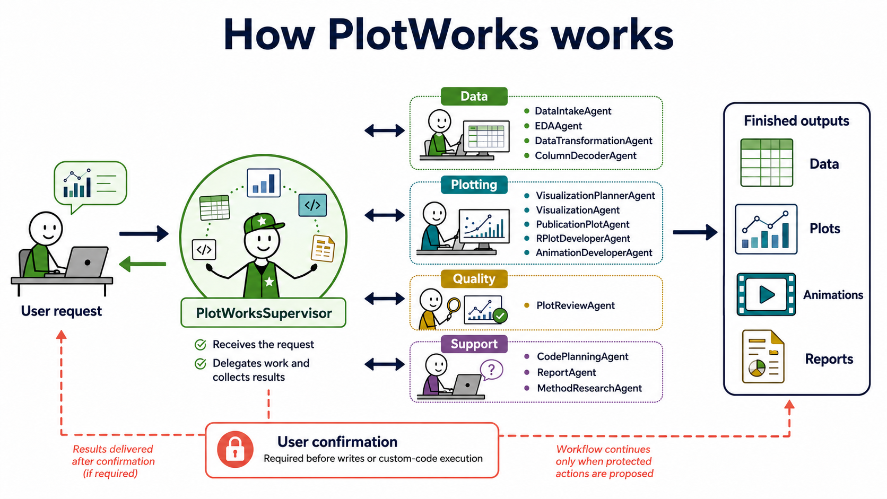
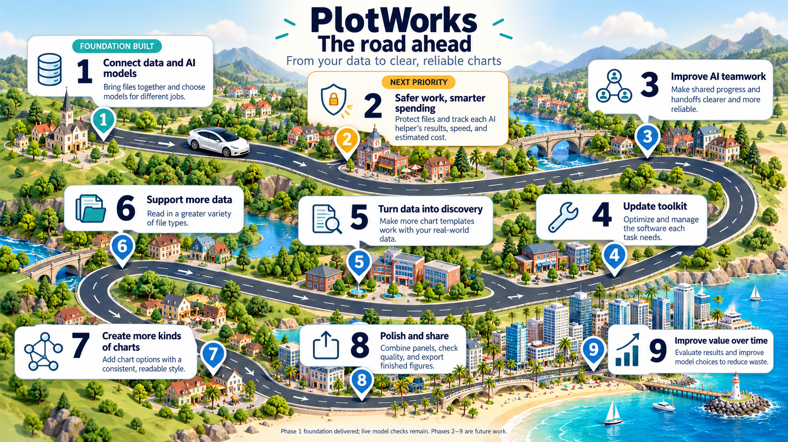

# PlotWorks

**PlotWorks** is a agentic AI workflow using the Google ADK framework for performing exploratory data analysis and creating high-quality plots in Python and R.

## Agent workflow





## Project structure

```text
PlotWorks/
├── agent.py              # Supervisor definition
├── agents/               # Specialist definitions
├── tools/                # Data, plotting, review, and reporting tools
├── plot_styles/          # Python themes, palettes, and export settings
├── plot_manifests/       # Approved plot recipes and defaults
├── r_plot_library/       # Shared R styles, recipes, and setup scripts
├── examples/             # Example transformations and animations
├── data/                 # Source datasets
├── outputs/              # Generated data, figures, reports, and code
├── requirements.txt      # Python dependencies
└── .env.example          # Configuration template
```

Keep source data in `data/`; PlotWorks keeps its handiwork in `outputs/`.

## Specialist agents

| Agent | Role |
|---|---|
| `DataIntakeAgent` | Locates and inspects datasets. |
| `EDAAgent` | Produces exploratory summaries. |
| `DataTransformationAgent` | Describe how data is transformed or prepared |
| `VisualizationPlannerAgent` | Chooses the most suitable plotting route. |
| `VisualizationAgent` | Creates deterministic Python plots. |
| `ColumnDecoderAgent` | Maps column names to expected plotting roles. |
| `PublicationPlotAgent` | Renders packaged ggplot2 recipes and manages palette proposals. |
| `RPlotDeveloperAgent` | Proposes custom R plots. |
| `AnimationDeveloperAgent` | Produces standard or custom animations. |
| `PlotReviewAgent` | Checks raster dimensions, validity, and looks for empty file outputs. |
| `CodePlanningAgent` | Drafts Python or R coding plans. |
| `ReportAgent` | Creates Markdown reports. |
| `MethodResearchAgent` | Researches plotting methods when requested. |
| `PythonTransformDeveloperAgent` | Custom Python transformations. |
| `ReasoningAgent` |  Complex planning and debugging. |

For setup and runtime problems, see [TROUBLESHOOTING.md](TROUBLESHOOTING.md).

The supervisor agent chooses the smallest set of specialists needed for each request.
Built-in tools handle routine work, while coding specialists stand by for
unforeseen coding requests and for creating novel R figures.

`PlotWorksSupervisor` is the sole user-facing agent. Specialist agents operate behind scenes as directed by the
the supervisor. `PlotWorksSupervisor` receives the user's request, delegates tasks to specialists, 
presents previews and proposals, and reports the final results.

## Core capabilities

PlotWorks can:

- Detect CSV, TSV, Excel, JSON, text, DATA, BED, and BED.GZ files.
- Perform joins, concatenation, unions and coalescing.
- Run exploratory data analysis using built-in functions and code generated on the fly.
- Summarize BED intervals, scores, strands, and inferred chromosome sizes.
- Map inconsistent column names to likely semantic roles.
- Write Python code for transforming data in unforeseen situations.
- Create polished Python plots using the `pretty_*` functions.
- Render 20 ggplot2 plot bioinformatics recipes from simulated or real data.
- Apply a selection of palettes to plots.
- Write R code for plotting when no recipe fits.
- Create custom animated R/gganimate figures as GIF or MP4.
- Validate generated code and save it with run metadata.
- Run technical checks for missing, invalid, or nearly blank raster plots.
- Save Markdown analysis reports.
- Supports configuring models for different tasks. Allowing for lower costs on less complex tasks.

## Installation

PlotWorks needs Python, R, and at least one supported model API key. Install Git
if you are cloning the repository. MP4 animation also requires FFmpeg on your
system path.

The project pins `google-adk==2.5.0`, the version used to verify its confirmation
workflow. Install from `requirements.txt` instead of choosing ADK packages one
by one; dependency roulette is a poor visualization technique.

### Linux, macOS, or WSL

From the cloned repository:

```bash
cd PlotWorks
python3 -m venv .venv
source .venv/bin/activate
python -m pip install --upgrade pip
python -m pip install -r requirements.txt
cp .env.example .env
```

Install the R plotting packages:

```bash
Rscript r_plot_library/ggplot2_cases/setup.R
Rscript r_plot_library/setup_animations.R
```

### Windows PowerShell

From the cloned repository:

```powershell
Set-Location PlotWorks
py -m venv .venv
.\.venv\Scripts\Activate.ps1
python -m pip install --upgrade pip
python -m pip install -r requirements.txt
Copy-Item .env.example .env
```

Make sure `Rscript.exe` is available from PowerShell, then install the R
dependencies:

```powershell
Rscript --version
Rscript .\r_plot_library\ggplot2_cases\setup.R
Rscript .\r_plot_library\setup_animations.R
```

If PowerShell blocks virtual-environment activation or an R package fails to
install, see [TROUBLESHOOTING.md](TROUBLESHOOTING.md).

## Model configuration

Open `.env` and configure one or more providers. Keep the other provider entries absent
or commented out, if using a single provider.

Gemini:

```env
PROVIDER=gemini
MODEL=gemini-flash-latest
GOOGLE_API_KEY=PASTE_YOUR_GEMINI_API_KEY_HERE
```

Claude through LiteLLM:

```env
PROVIDER=litellm
MODEL=anthropic/claude-3-5-sonnet-20241022
ANTHROPIC_API_KEY=PASTE_YOUR_ANTHROPIC_API_KEY_HERE
```

OpenAI through LiteLLM:

```env
PROVIDER=litellm
MODEL=openai/gpt-4o-mini
OPENAI_API_KEY=PASTE_YOUR_OPENAI_API_KEY_HERE
```

For Claude and OpenAI, `litellm` is the ADK adapter; the prefix in `MODEL`
selects the model provider.

Tiered multi-model approach:

```env
PROVIDER=litellm
MODEL=anthropic/claude-opus-5-5 # 'MODELS overrides this setting, so there is no need to input anything here.
ANTHROPIC_API_KEY=PASTE_YOUR_ANTHROPIC_API_KEY_HERE

MODELS='["anthropic/claude-sonnet-5-5","anthropic/claude-haiku-5-5","anthropic/claude-opus-5-5"]'

MODEL_FAST=anthropic/claude-haiku-5-5
MODEL_STANDARD=anthropic/claude-sonnet-5-5
MODEL_CODING=anthropic/claude-sonnet-5-5
MODEL_REASONING=anthropic/claude-opus-5-5
```
One registered model handles every task, `MODELS` takes precedence over `MODEL`, and settings changes require restarting PlotWorks.

## Run PlotWorks

Run ADK from the directory that contains `PlotWorks/`, not from inside the
project directory.

Linux, macOS, or WSL:

```bash
cd ..
source PlotWorks/.venv/bin/activate
adk web --port 8000
```

Windows PowerShell:

```powershell
Set-Location ..
.\PlotWorks\.venv\Scripts\Activate.ps1
adk web --port 8000
```

Open the address reported by ADK and select `PlotWorks`. For a terminal-only
session, replace `adk web --port 8000` with `adk run PlotWorks`.

## Use PlotWorks

1. Put source files in `PlotWorks/data/`.
2. Tell the supervisor which file to inspect and what you want to learn or
   visualize.
3. Review any proposed transformation or generated code.
4. Use the ADK confirmation control when PlotWorks asks to save transformed
   data, execute generated code, or change a persistent setting.
5. Collect the result from `PlotWorks/outputs/`.

Useful prompts include:

```text
Inspect data/demo_general.csv, summarize its columns and missing values, and
recommend two plots. Do not save anything yet.
```

```text
Create a polished scatter plot of yield_kg versus rainfall_mm, colored by
treatment. Save it as yield_vs_rainfall.png.
```

```text
Render case 06-raincloud from simulated data using the ggrateful
terrapin_station palette.
```

For an animation that requires reshaping data:

```text
Inspect data/FAOSTAT_data_en_12-8-2024.xls. Preview the transformation needed
for an animated scatter plot of area harvested versus yield over Year, colored
by Area and sized by area harvested. Do not alter the source. Ask for
confirmation before saving the transformed table, then create the GIF.
```

Templates for the cotton-seed example are available under
`examples/transformations/` and `examples/animations/`.

## Inputs and outputs

Use paths relative to `PlotWorks/` whenever possible. When running under WSL,
use WSL paths such as `/mnt/c/...`, not `C:\...` paths. External absolute input
paths are disabled unless `.env` contains:

```env
ALLOW_ABSOLUTE_DATA_PATHS=true
```

| Result | Default location |
|---|---|
| Transformed data and metadata | `outputs/data/transformed/` |
| Static plots | `outputs/plots/` |
| Animations | `outputs/animations/` |
| Analysis reports | `outputs/reports/` |
| Generated code and run metadata | `outputs/code/` |
| Model usage and latency logs | `outputs/logs/model_calls.jsonl` |

Plot filenames cannot include directories. Transformation output names may use
safe relative subfolders under `outputs/data/transformed/`.

## Data-protection

PlotWorks never transforms a source file in place.

When a plot requires transformation, `PlotWorksSupervisor` invokes a confirmation tool, and the user approves or rejects the action in the ADK Web dialog. Any approved results are written as a new file under:

```text
outputs/data/transformed/
```

A metadata file records the source path, source SHA-256 hash, operations, before/after shape, and output path. Metadata records every contribution from an agent. Changed inputs or plans require a fresh preview, and existing output files are not overwritten.

### How the confirmation dialog works

All confirmation-required tools are registered directly on `PlotWorksSupervisor`. Specialist agents preview
and validate work and return a proposal, but they do not invoke
writes from inside an `AgentTool`.

The supervisor then calls the corresponding tool, causing ADK Web to display its
confirmation control. Providing approaval as a normal chat message does
not replace that control. Confirm or reject the pending action in the UI.

## Data transformation routes

### Built-in transformations

`DataTransformationAgent` has several preset operations:

```text
select_columns
drop_columns
rename_columns
filter_rows
convert_types
fill_missing
drop_missing
drop_duplicates
replace_values
derive_column
sort_values
aggregate
pivot_table
melt
reset_index
join / merge (inner, left, right, outer, cross, semi, anti)
append_metadata
concat_rows / union_all
union_distinct
concat_columns
coalesce_columns
interval_join
```

Join previews report duplicate keys, unmatched rows, and potential row multiplication before saving.

See [Multi-dataset and model configuration](docs/MULTI_DATASET_AND_MODELS.md)
for detailed configuration, fallback behavior, execution limits, and metadata.

Single-table transformations use `preview_data_transformations()` followed by
`save_data_transformations()`. Multi-table transformations use
`preview_bundle_transformations()` followed by `save_bundle_transformation()`.
The supervisor presents the proposal and requests ADK confirmation before saving.

### Custom Python transformations

Custom transformations receive DataFrames through `transform_data(datasets)`.
They can return one DataFrame or a dictionary of output DataFrames.
`transform_data(data)` remains supported for one input.

```python
def transform_data(datasets):
    data = datasets["measurements"].copy()
    summary = data.describe(include="all").reset_index()
    return {"prepared": data, "summary": summary}
```
Generated-code previews use `preview_generated_bundle_transform()`, followed by
the same confirmed `save_bundle_transformation()` route.

Generated Python code can use pandas/numpy and approved installed packages configured
through `TRANSFORM_ALLOWED_IMPORTS`. Validation and runtime checks restrict file,
network, and system access. Execution occurs in a separate process with time and
resource limits. These are application-level safeguards. It is recommended to
review generated code before approving execution.

## Plotting routes

### 1. R bioinformatics recipes

Predefined bioinformatics recipes are available and can be applied to the appropriate inputs. Note, some recipes require several input files. Every recipe includes simulated data for preview and testing.
Some accept a single data table directly; others require a
transformation or an additional adapter for matrices, networks,
hierarchies, or multiple linked tables.

Use this route for figures such as Manhattan plots, volcano-style plots,
raincloud plots, Sankey diagrams, treemaps, and the other cataloged cases.

#### Palette providers and defaults

Several palettes are currently supported for plotting:

- `recipe`: preserve each case's original colors.
- `plotworks`: use the built-in palettes shared with Python plots.
- `ggrateful`: choose from the 16 Grateful Dead-inspired palettes supplied by the
  `ggrateful` R package.

Use `list_plot_palettes()` to inspect available names and metadata. A palette
explicitly requested by the user takes precedence over the defaults. Saved defaults
takes precedence over the recipe color schemes.

To request rendering of a specific case drawn with a palette of your choice:

```text
Render case 06-raincloud from simulated data using the ggrateful
terrapin_station palette and save it under palette_examples/raincloud/.
```

To compare several palettes on one selected case without using an agent, run
`tests/render_case_palette_variants.py`. It can render all 16 `ggrateful`
palettes or a named subset and writes a JSON/CSV summary beside the images.
Examples are provided in the testing section below.

To make a preferred palette the default for any particular case, PlotWorks uses
`set_ggplot2_case_palette_default()`. The choice
is stored in `plot_manifests/ggplot2_cases.json`. Resetting the provider to `recipe` restores the
original case colors.

### 2. Python plots

Python plotting functions

```text
pretty_histogram
pretty_barplot
pretty_scatter
pretty_lineplot
pretty_boxplot
pretty_violin
pretty_heatmap
pretty_faceted_plot
pretty_manhattan
pretty_genomic_track
create_pretty_charts
```

These functions are preferred by the program for typical plotting cases.

### 3. Custom R plotting

When no ggplot2 recipe fits and R offers a meaningful advantage,
`RPlotDeveloperAgent` can write a new ggplot2 function.

This route is available by default and is used only when the user requests
a novel R figure or the visualization planner determines that R provides a meaningful
advantage over a recipe or a `pretty_*` Python function.

Generated code must define:

```r
build_plot <- function(data) {
  # plotting code
  return(plot_object)
}
```

Newly Generated scripts and metadata are saved under `outputs/code/custom_r_runs/`.

### 4. Animated R plotting

PlotWorks provides support for creating animated plots (GIF or MP4) with two paths:

#### Animated scatter

`render_animated_scatter()` accepts explicit x, y, time/state, color, size, and
label columns. It is the preferred route for bubble-chart-like motion through
time or states.

#### Custom gganimate

For more complex animated figures, `AnimationDeveloperAgent` can write:

```r
build_animation <- function(data) {
  # ggplot2 + gganimate code
  return(animation_object)
}
```

PlotWorks can create animations including animated scatter,
line, bar, point, and other ggplot2-compatible transitions when the data and
requested context support them.

Animations are written to:

```text
outputs/animations/
```

Generated scripts and run metadata are written to:

```text
outputs/code/custom_r_animation_runs/
```

### BED files

PlotWorks recognizes BED files through BED12. It treats the first three columns
as `chrom`, `chromStart`, and `chromEnd`, and can summarize interval counts,
lengths, scores, strands, and inferred chromosome sizes.

Custom BED-like tables can instead be loaded as ordinary tables using explicit
`loading_options`, including `format="table"`, `header`, `names`, `sep`, and
`dtype`. This preserves headers and columns
without assigning standardized BED meanings to them. Column names and
coordinate conventions must be supplied explicitly when needed.

## Future work on Plotworks



